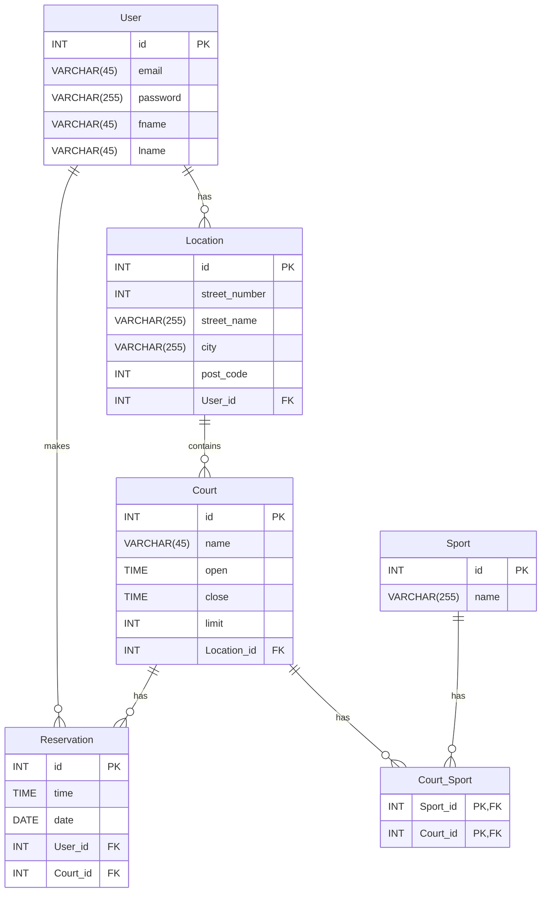

# Data Model

Replace the example with your own model. Requirements: at least 3 entities, one 1:N and one M:N relationship.

## Entities

| Entity | Description | Important rules / constraints |
|--------|-------------|-------------------------------|
| User | Stores basic info for users |  |
| Location | Stores basic info for locations | User_id represents the locations owner(user) |
| Reservation |  |  |
| Court |  |  |
| Sport | Sports each court can be played on |  |
| Court_Sport |  |  |

## Business rules
<!-- e.g. "A room cannot have two bookings that overlap in time." -->
